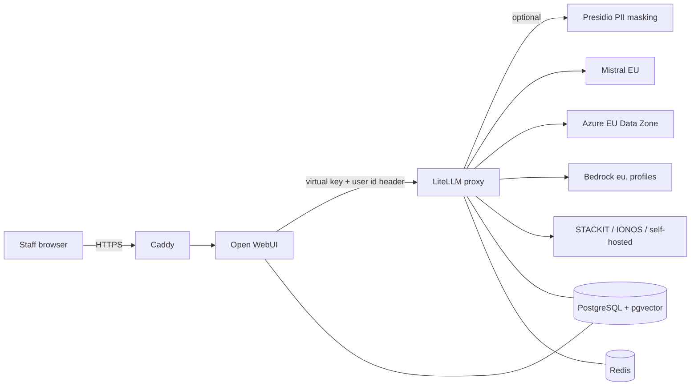

# LiteLLM Proxy + Open WebUI (Docker Compose): self-hosted LLM gateway

LiteLLM proxy and Open WebUI in one Docker Compose stack: a self-hosted LLM gateway with
per-user budgets, EU-hosted models and privacy defaults. One `docker compose up`, tested in CI.

A ChatGPT-style chat for your staff, on your own server, with a budget per person and prompts
kept out of LiteLLM's spend logs.

- **LiteLLM proxy** as the LLM gateway: one OpenAI-compatible API in front of Azure OpenAI,
  AWS Bedrock, Google Vertex AI, Mistral, STACKIT, IONOS, OVHcloud, Scaleway and self-hosted models.
- **Open WebUI** as the chat interface, with document search (pgvector) and Entra ID login.
- **Budgets and rate limits** per Open WebUI user, per team and per key, without an enterprise licence.
- **Privacy defaults**: EU endpoints, no prompts in spend logs, retention for logs and chats,
  optional PII masking with Presidio for German and English.
- **15 end-to-end tests** against a mock model plus config checks, in CI on every push and once a week.

```bash
git clone https://github.com/pexon-consulting/litellm-open-webui
cd litellm-open-webui
# .env with random secrets
./scripts/init-env.sh
# add MISTRAL_API_KEY to .env, or pick another provider from examples/providers/
docker compose up -d --wait
# Open WebUI key + default budget per user
python3 scripts/bootstrap.py
```

Then open <http://localhost:3000> (the first account becomes admin). The LiteLLM admin UI is at
<http://localhost:4000/ui>, user `admin`, password = `LITELLM_MASTER_KEY` from `.env`.
Step by step with explanations: [Quick start](docs/quickstart.md).

## Contents

- [What you get](#what-you-get)
- [How it fits together](#how-it-fits-together)
- [What is tested](#what-is-tested)
- [EU-hosted models](#eu-hosted-models)
- [Guides](#guides)
- [Skill for Claude Code and Codex](#skill-for-claude-code-and-codex)
- [FAQ](#faq)
- [Disclaimer](#disclaimer)

## What you get

| File | Purpose |
| --- | --- |
| `compose.yaml` | LiteLLM v1.105.1, Open WebUI v0.12.2, PostgreSQL 16 + pgvector, Redis 7.4.11. All ports on 127.0.0.1. |
| `compose.pii.yaml` | Presidio PII masking before prompts leave your server, with a German spaCy model. |
| `compose.tls.yaml` | Caddy with automatic HTTPS. Only Open WebUI is public; LiteLLM stays private. |
| `compose.entra.yaml` | Login with Microsoft Entra ID for Open WebUI. |
| `compose.test.yaml` | Mock LLM for tests and trying things out without a provider key. |
| `litellm/config.yaml` | Proxy settings: fallbacks, retries, logging off, retention, per-user budgets. |
| `litellm/models.yaml` | Your models. Default: Mistral via `api.eu.mistral.ai`, with EU prices. |
| `litellm/guardrails.yaml`, `litellm/guardrails.pii.yaml` | Guardrails: empty by default; the Presidio guardrail used by `compose.pii.yaml`. |
| `presidio/` | Analyzer image with the German spaCy model, NLP settings and custom recognizers. |
| `caddy/Caddyfile` | Reverse proxy config for `compose.tls.yaml`, with security headers. |
| `postgres/init/` | Creates the Open WebUI database with pgvector on the first start. |
| `examples/providers/` | Ready model entries for 11 providers, with data residency notes and sources. |
| `scripts/` | `init-env.sh` (secrets), `bootstrap.py` (key and budgets), `purge-chats.sh` (chat retention). |
| `tests/` | End-to-end tests, config checks, the mock LLM and its model list. |
| `docs/` | The guides listed [below](#guides). |
| `.env.example` | All variables with comments. `init-env.sh` writes the real `.env`. |
| `.github/workflows/e2e.yml` | CI: config checks and the end-to-end tests on every push and weekly. |
| `skills/` | A skill that lets Claude Code or Codex run the admin tasks. |

## How it fits together



Caddy only runs with `compose.tls.yaml`; without it, Open WebUI listens on 127.0.0.1:3000.

Open WebUI handles login, chats and documents. Every request goes through LiteLLM with one
virtual key plus the header `X-OpenWebUI-User-Id`. LiteLLM maps that header to an end user, so
spend and budgets work per person. It picks the model, retries, falls back and, with the
optional Presidio overlay, masks detected personal data before the request goes to the provider
(detection is not complete, see [PII masking](docs/pii-masking.md)).

## What is tested

`tests/test_gateway.py` runs against the real `config.yaml` with a mock model. Every row below
is a test, and several show where LiteLLM behaves differently from its own docs.

| Behaviour | Result in LiteLLM v1.105.1 |
| --- | --- |
| Budget of a key or user used up | HTTP **422** `budget_exceeded` (the LiteLLM docs say 429) |
| Rate limit (`rpm_limit`) | HTTP 429 |
| Model not allowed for the key | HTTP 403, the provider is never called |
| Open WebUI key on a management route (`/key/generate`) | HTTP 403 (`allowed_routes: llm_api_routes`) |
| Fallback when a model fails | works, unless the worst-case cost reservation fills the key budget ([details](docs/budgets.md)) |
| Spend per Open WebUI user | tracked via the user id header |
| Prompts in the spend log table | not stored |
| PII masking | the provider receives `<PERSON> aus <LOCATION>, IBAN <IBAN_CODE>, an <EMAIL_ADDRESS>` |
| Sign-up after the first admin | closed automatically by Open WebUI; when reopened, new users are "pending" |
| Open WebUI to LiteLLM | user header arrives, spend lands on the right person |

> **Warning:** never run the tests against a production stack. The test overlay replaces your
> models with a mock, and on a fresh stack the tests sign up the first Open WebUI admin. Use a
> separate clone with its own `COMPOSE_PROJECT_NAME` and ports, see
> [Run the tests](docs/quickstart.md#run-the-tests).

```bash
docker compose -f compose.yaml -f compose.pii.yaml -f compose.test.yaml up -d --wait
python3 scripts/bootstrap.py
python3 -m venv .venv && .venv/bin/pip install pytest pyyaml
.venv/bin/pytest tests -v
```

## EU-hosted models

Each file in `examples/providers/` contains working model entries, what "EU" means in the
provider's own words, and the source with date. Short version (as of 16 October 2026):

| Provider | EU option | Watch out for |
| --- | --- | --- |
| Mistral | `api.eu.mistral.ai` | costs 1.1x, 30-day abuse retention unless ZDR |
| Azure OpenAI | Data Zone Standard deployment | Global SKU may process anywhere; block it by policy |
| AWS Bedrock | `eu.` inference profiles from eu-central-1 | from eu-central-2 / eu-west-2 the profile includes CH / UK |
| Google Vertex AI | `vertex_location: eu` | the `global` endpoint has no residency guarantee |
| OpenAI | `eu.api.openai.com` | needs approval, not self-service |
| STACKIT, IONOS | German data centres | add prices yourself, LiteLLM does not know them |
| OVHcloud, Scaleway | French data centres | Scaleway may keep requests up to two weeks on abuse or errors |
| Anthropic API | none | use Claude via Bedrock or Vertex in the EU |

Comparison, prices and pitfalls: [EU-hosted LLMs with LiteLLM](docs/eu-models.md).

## Guides

**Setup**
- [Install LiteLLM proxy and Open WebUI: step-by-step Docker Compose setup](docs/quickstart.md)
- [LiteLLM config.yaml explained](docs/configuration.md)
- [Open WebUI with LiteLLM: connection, users and settings that matter](docs/open-webui.md)

**Costs and control**
- [LiteLLM budgets and rate limits: per user, per key, per team](docs/budgets.md)
- [LiteLLM open source vs enterprise](docs/open-source-vs-enterprise.md)
- [LLM gateway comparison: LiteLLM and the alternatives](docs/llm-gateway-comparison.md)

**Data protection**
- [EU-hosted LLMs with LiteLLM](docs/eu-models.md)
- [LiteLLM GDPR checklist: internal LLM gateway with Open WebUI](docs/gdpr.md)
- [PII masking with Presidio and LiteLLM (German and English)](docs/pii-masking.md)

**Operations**
- [Running LiteLLM in production: HTTPS, backups, upgrades, security](docs/production.md)
- [Open WebUI single sign-on with Microsoft Entra ID](docs/sso-entra-id.md)
- [Troubleshooting: common errors and fixes](docs/troubleshooting.md)

## Skill for Claude Code and Codex

[`skills/litellm-gateway-admin`](skills/litellm-gateway-admin/SKILL.md) teaches a coding agent the
admin tasks of this stack: keys and teams, budgets per user, spend reports, adding a provider,
reading 422/429/403 answers. Copies in `.claude/skills/` (Claude Code) and `.agents/skills/`
(Codex) make it available as soon as you open the clone with either tool.

## FAQ

**What is an LLM gateway?**
A service between your applications and the model providers. Clients use one OpenAI-compatible
endpoint, and the gateway handles provider keys, budgets, rate limits, fallbacks and logging in
one place. LiteLLM is the gateway in this stack. Alternatives and when you need one:
[LLM gateway comparison](docs/llm-gateway-comparison.md).

**How do I connect Open WebUI to LiteLLM?**
Point Open WebUI's OpenAI connection at `http://litellm:4000/v1` with a LiteLLM virtual key, and
turn on `ENABLE_FORWARD_USER_INFO_HEADERS` so LiteLLM sees who sent the request. `compose.yaml`
and `scripts/bootstrap.py` do both. Details: [Open WebUI with LiteLLM](docs/open-webui.md).

**Can I run this on Kubernetes?**
Not with this repository: it ships Docker Compose files only. LiteLLM and Open WebUI both publish
Helm charts, and the settings in `litellm/config.yaml` and the Open WebUI environment variables
in `compose.yaml` carry over. We have not tested a Kubernetes setup.

**Is LiteLLM free?**
The proxy is MIT-licensed. Everything in this repository works without a licence. Some features
need LiteLLM Enterprise, for example admin UI SSO beyond 5 users, JWT auth and tag budgets. See
[open source vs enterprise](docs/open-source-vs-enterprise.md).

**Why LiteLLM and Open WebUI together?**
Open WebUI is the chat for people, LiteLLM is the gateway for models, keys and costs. Other
applications (scripts, n8n, coding agents) can use the same LiteLLM endpoint with their own key
and budget.

**Does this make my LLM use GDPR compliant?**
No software does that on its own. This stack gives you the technical settings (EU endpoints,
data minimisation, retention, masking). The legal side (contracts with providers, record of
processing, works council, DPIA) stays with your organisation. See the
[GDPR checklist](docs/gdpr.md).

**Can I remove the Open WebUI logo?**
Only with 50 or fewer users in any rolling 30 days, written permission or an Open WebUI
enterprise licence. This repository leaves the branding as it is.

**What does it cost to run?**
Measured at idle: about 1.8 GB RAM for the base stack and 2.8 GB with PII masking (Presidio
alone needs about 1 GB). Plan 4 GB without and 8 GB with masking. Model costs depend on use;
budgets cap them per person.

**Which LiteLLM version is safe?**
This repository pins v1.105.1. Never use 1.82.7 or 1.82.8 (supply-chain malware, March 2026) and
not the `main-latest` image, which is no longer updated. Details in
[production](docs/production.md).

## Disclaimer

This repository describes technical settings and quotes laws and provider documents as of
16 October 2026. It is not legal advice, and the authors are not lawyers or data protection
officers. There is no guarantee that a setup based on it complies with the GDPR or other law.
You remain the controller (Art. 4(7) GDPR) and are responsible for the legal basis, the record
of processing (Art. 30), the DPIA decision (Art. 35), data processing agreements with providers
(Art. 28), transfer safeguards (Art. 44 ff.) and works council involvement. Provider terms
change; the provider's current documentation and your contract prevail. Provided "as is" under
the MIT License, without warranty.

LiteLLM, Open WebUI, Presidio and all other product and company names are names or trademarks
of their owners. This project is not affiliated with any of them. Licences of the images used: [NOTICE](NOTICE).

Licence: [MIT](LICENSE). Changes: [CHANGELOG.md](CHANGELOG.md). Security: [SECURITY.md](SECURITY.md).

Maintained by Pexon Consulting. If you want help running LiteLLM in your company, see our
[LiteLLM implementation service](https://pexon-consulting.de/ki-beratung/litellm/litellm-implementierung/).
